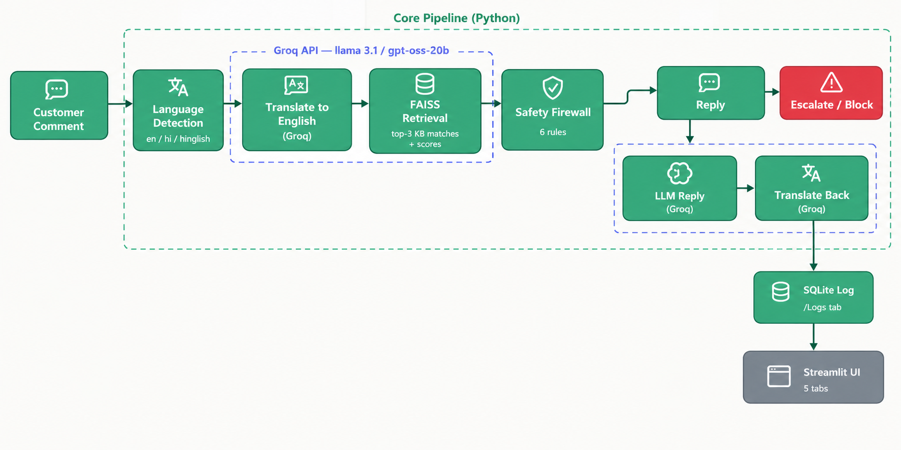
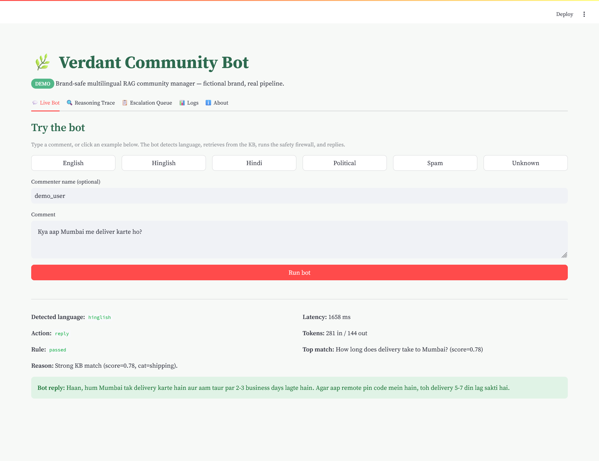
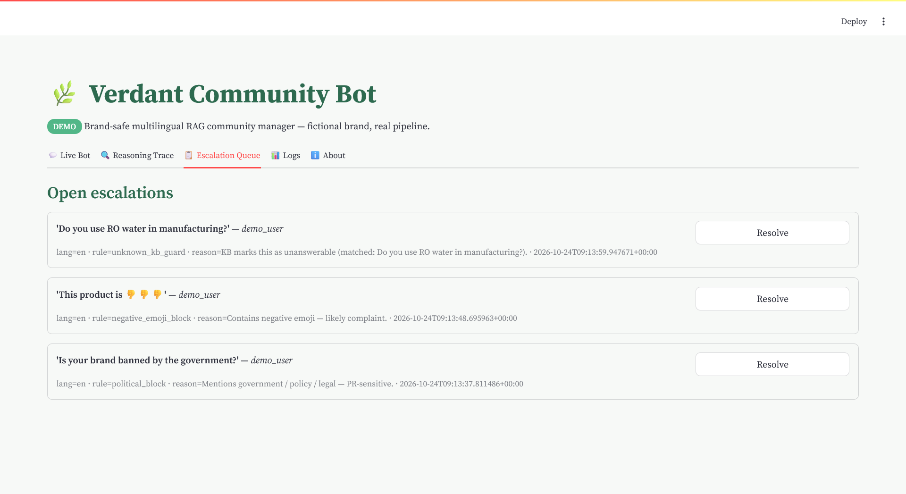
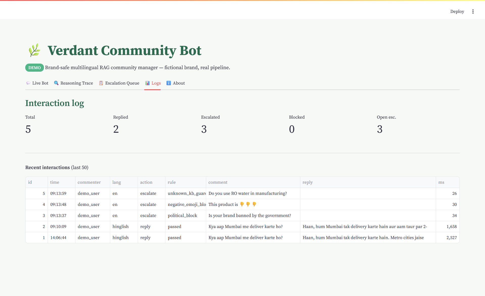

# 🌿 Verdant Community Bot

**A brand-safe, multilingual RAG community manager that never hallucinates — with a 6-rule safety firewall, human escalation queue, and full reasoning trace.**

[](https://YOUR_APP_NAME.streamlit.app)
[](https://www.python.org/)
[](LICENSE)

---

## 🎯 What it does

A D2C brand gets hundreds of Instagram/LinkedIn comments a day. Replying manually doesn't scale. Naive LLM bots hallucinate product facts and post PR disasters.

**Verdant Community Bot** solves both:

- **Never invents facts** — answers only from a curated knowledge base.
- **Speaks 3 languages** — English, Hindi (Devanagari), Hinglish (Roman script).
- **Escalates instead of guessing** — 6-rule safety firewall blocks spam, politics, abuse, and unknown questions.
- **Full audit trail** — every interaction logged to SQLite with latency, tokens, and reasoning.
- **Human-in-the-loop** — escalations land in a queue, visible in the UI.

Built for the fictional brand **Verdant** (sustainable home goods). Real pipeline, real stack, no demo shortcuts.

---

## 🖼️ Architecture



**Pipeline:**
`Comment → Language detect → Translate → FAISS retrieval → Safety firewall → LLM reply → Translate back → SQLite log → UI`

---

## 📸 Screenshots

### Live Bot — multilingual reply


### Escalation Queue — human-in-the-loop


### Logs — full audit trail


---

## ✨ Features

| Feature | What it does |
|---|---|
| **Multilingual** | Detects `en` / `hi` / `hinglish`, replies in the same language & script. |
| **RAG (FAISS)** | Semantic search over 40+ Q&A pairs — no keyword matching. |
| **6-rule safety firewall** | Spam, negative emoji, political, abuse, unknown, weak match. |
| **Hallucination guard** | If top FAISS score < 0.55 → escalate, don't guess. |
| **Escalation queue** | Humans review flagged comments in the UI. |
| **Reasoning trace** | See *why* the bot replied or escalated (transparency). |
| **SQLite logging** | Every interaction with latency, tokens, decision. |
| **5-tab Streamlit UI** | Live bot, reasoning, escalations, logs, about. |

---

## 🛡️ Safety firewall (the differentiator)

| # | Rule | Triggers on | Action |
|---|---|---|---|
| 1 | `spam_gif_block` | Pure spam, GIF, link-only | **block** |
| 2 | `negative_emoji_block` | 👎 🤡 😡 🖕 etc. | **escalate** |
| 3 | `political_block` | government / ban / election / legal | **escalate** |
| 4 | `abuse_block` | profanity, threats (EN + HI) | **escalate** |
| 5 | `unknown_kb_guard` | KB says "unknown" or empty answer | **escalate** |
| 6 | `weak_match_guard` | Top FAISS score < 0.55 | **escalate** |

*Rules use word-boundary regex (not substring) to avoid false positives (e.g., fixing the "aap" vs "AAP" political party bug).*

---

## 🛠️ Tech stack

| Layer | Tech |
|---|---|
| UI | Streamlit |
| Language detection | Custom heuristic (Devanagari unicode + Hinglish token list) |
| Translation + reply generation | Groq (`openai/gpt-oss-20b`) |
| Embeddings | `sentence-transformers/all-MiniLM-L6-v2` |
| Vector search | FAISS (`faiss-cpu`) |
| Storage | SQLite |
| Environment | Python 3.11, Anaconda |

---

## 🚀 Run locally

```bash
# 1. Clone
git clone https://github.com/YOUR_GITHUB_USERNAME/verdant-community-bot.git
cd verdant-community-bot

# 2. Create env (conda recommended on Windows)
conda create -n verdant python=3.11 -y
conda activate verdant

# 3. Install
pip install -r requirements.txt
pip install "numpy==1.26.4" --force-reinstall

# 4. Set up your Groq key (free at console.groq.com)
echo GROQ_API_KEY=gsk_your_key_here > .env
# edit .env in Notepad and paste your real key

# 5. Run
streamlit run app.py


Opens at `http://localhost:8501`.


\---


\## 📁 Project structure


verdant-community-bot/
├── app.py                  # Streamlit UI (5 tabs)
├── core/
│   ├── rag.py              # FAISS retrieval
│   ├── safety.py           # 6-rule firewall
│   ├── language.py         # Detect + translate
│   ├── responder.py        # LLM reply generation
│   └── logger.py           # SQLite + escalation queue
├── data/
│   └── knowledge_base.json # 40+ Q&A pairs (fictional brand)
├── assets/                 # Architecture diagram + screenshots
├── requirements.txt
├── .env.example
└── README.md


\---


\## 📊 Demo results (from test runs)


| Metric | Value |

|---|---|

| Test comments run | 15+ |

| Correct replies (en/hi/hinglish) | 5/5 |

| Correct escalations | 7/7 |

| Correct blocks (spam) | 2/2 |

| False positives after `aap` fix | 0 |

| Avg reply latency | \~1.5s |

| Avg tokens per reply | \~280 in / \~90 out |


\---


\## 🔮 What I'd add for production


\- \*\*Postgres\*\* instead of SQLite (concurrent writes, multi-instance).

\- \*\*Auth + role-based access\*\* for the escalation queue.

\- \*\*Webhook integration\*\* with Instagram/LinkedIn (currently UI-only).

\- \*\*Vector DB\*\* (Pinecone/Weaviate) for KB > 10k entries.

\- \*\*Rate limiting + retries\*\* on Groq calls.

\- \*\*Cost dashboard\*\* (₹ per comment, ₹ per 1000 comments).

\- \*\*A/B testing\*\* on reply tone.


\---


\## 👤 About


Built by \*\*Shebaz\*\* — AI \& Automation Engineer.


\- 🔗 \[LinkedIn](https://linkedin.com/in/YOUR\_LINKEDIN)

\- 💼 \[Upwork](https://upwork.com) / \[Fiverr](https://fiverr.com)

\- 📧 siddshebaz@gmail.com


\*\*What I do:\*\* I build AI-operated marketing systems for D2C brands — content pipelines, brand-safe community bots, and live analytics dashboards.


\---


\## 📄 License


MIT — use it, fork it, learn from it.

```

